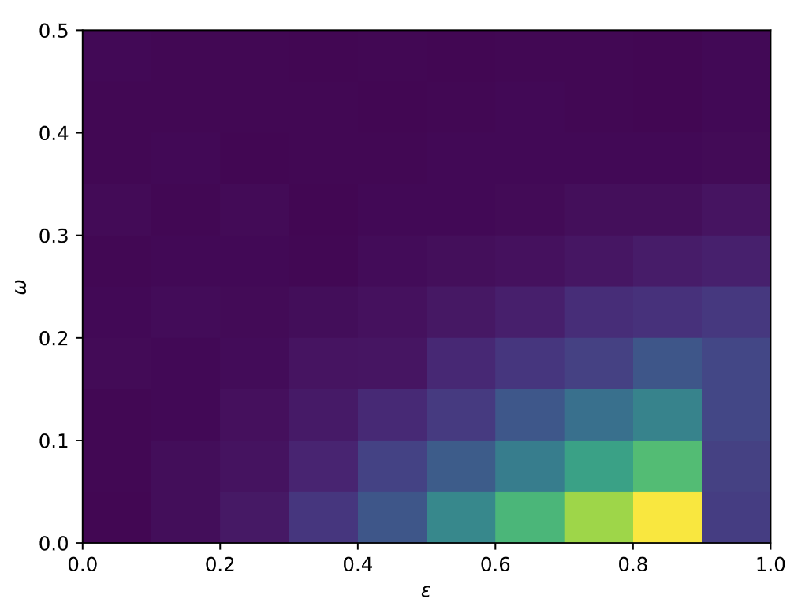

---
# Metadata
title: "Preliminary kernel identifiability experiments"
date: "2025-10-27"

# Formatting
format: 
    html:  # no revealjs for this document
        self-contained: true  # turn on when sharing
        fig-align: center
        code-fold: show

execute:
    output: true
    echo: true
    eval: true  # turn off when debugging markdown/formatting
---

```{python}
#| label: setup.environment
#| output: false
#| echo: false

import os
import random
import sys

import arviz as az
import cmdstanpy as csp
import matplotlib.pyplot as plt
import matplotlib as mpl
from netgraph import Graph
import networkx as nx
import numpy as np
import seaborn as sns
from scipy.stats import mode
from scipy.special import logit
from sklearn.metrics import root_mean_squared_error
from tqdm import tqdm
import pandas as pd

# Add project source to path
sys.path.append(
    os.path.join(
        '..',  # logs -> notes
        '..',  # notes -> docs
        '..',  # docs -> project root
    )
)

import src
```

```{python}
#| label: setup.reproducibility
#| echo: false

random.seed(37)

DEBUG: bool = True
```

# Summary

I test the ability of our model inference to distinguish two strongly differentiated kernels in a block model of varying block separability and node-kernel associations.
I find suspiciously strong capability and end with a confusion on the possibility of such a low error on the inference. 

# Introduction

The goal of this preliminary experiment is to look for some capability of the mixture model inference to find the underlying kernels in a 2-block model when the association of kernels to blocks is noisy.
This is meant to closely follow the figure in [Nick's repository](https://github.com/nwlandry/heterogeneous-complex-network-reconstruction/blob/main/Figures/omega_vs_epsilon.pdf), shown below in @fig-prior-nick as well.

{#fig-prior-nick}

# Setup (09:53)

## Network structure 

The main goal of this preliminary experiment is to assess the model inference capabilities;
as long as the network structure on which the contagion occurs is sufficiently large to promote mixing, we do not care much about the effect of the network size currently, so it will remain fixed at some manageable size.

```{python}
#| label: setup.structure.size_degree

# Population globals
NUM_PEOPLE: int = 256
AVG_DEGREE: int = 18
```

Our block mixing is controlled by $\varepsilon$ and has support[^1] $[0, 1)$.
This is just a preliminary crack at testing the model inference capabilities, we can start with a coarse sampling.

```{python}
#| label: setup.structure.epsilons

EPSILONS = np.linspace(
    start=0.05, stop=0.95,
    num=10
)
```

## Contagion parameters

Likewise, some aspects of the contagion are beyond the scope of the current experiment and will be fixed;
namely, the recovery rates and the seed nodes.

We want a scenario that is known to be separable (with respect to the individual kernel modes), so we will fixed relatively strongly differentiated $R_0$'s of 2 and 4.
The recovery rate throughout will be 0.1.

```{python}
#| label: setup.contagion.rates

# Shared contagion parameters
REP1: float = 2.00  # moderate(ish) reproduction number
REP2: float = 4.00  # moderate(ish) reproduction number
GAMMA: float = 0.1  # recovery rate
BETA1: float = REP1 * GAMMA / AVG_DEGREE  # infection rate
BETA2: float = REP2 * GAMMA / AVG_DEGREE  # infection rate
```

```{python}
#| label: setup.contagion.seed_nodes

# Sample seed nodes
NUM_SEEDS: int = 32  # number of initially infected persons
_seeds_block1 = set(random.sample(range(int(NUM_PEOPLE/2)), k=int(NUM_SEEDS/2)))
_seeds_block2 = set(random.sample(range(int(NUM_PEOPLE/2)+1, NUM_PEOPLE), k=int(NUM_SEEDS/2)))
_seeds = _seeds_block1 | _seeds_block2
x0 = [int(idx in _seeds) for idx in range(NUM_PEOPLE)]
```

```{python}
#| label: setup.contagion.kernel_modes

# Pure kernel modes
contagion_function = lambda nu, b: 1 - (1 - b) ** nu
c1 = contagion_function(np.arange(1, NUM_PEOPLE+1), BETA1)
c2 = contagion_function(np.arange(1, NUM_PEOPLE+1), BETA2)
```

The assignment of kernels to blocks is a parameter of experimental interest.
Specifically, we create two pure kernel states according to the above $\beta_1, \beta_2$.
In a setup without any noise in kernel assignment, the first $N/2$ nodes (all within the first block) are assigned the first pure kernel, and similarly for the remaining nodes and the second kernel.
Upon adding noise[^2], for each node in each block, with probability $\omega$ we assign that node the kernel of the *opposite* block.
That is, $\omega = 0$ corresponds to a lack of kernel assignment noise, and $\omega = \frac{1}{2}$ is a random assignment of kernels between the two blocks.

Similarly to $\varepsilon$, we will start with a rather coarse sampling over $\omega$.

```{python}
#| label: setup.contagion.omegas

OMEGAS = np.linspace(
    start=0.0, stop=0.5,
    num=10
)
```

```{python}
#| label: setup.contagion.mixing_kernels
# https://github.com/nwlandry/heterogeneous-complex-network-reconstruction/blob/main/run_dynamical_inference.ipynb
def mix_kernels(n, k, omega, c1, c2):
    c = np.zeros((n, k))
    for i in range(n):
        u = random.random()
        if i < n / 2:
            c[i] = (u < omega) * c1 + (u >= omega) * c2
        else:
            c[i] = (u >= omega) * c1 + (u < omega) * c2

    return c
```

And lastly, we set some hyperparameters related to the hyperprior parameters and contagion time.

```{python}
#| label: setup.contagion.hyperparameters

# Our model hyperpriors
AVERAGE_SCALE: float = 1.0    # mu dirichlet location scaling
DEVIATION_SCALE: float = 1.0  # sigma exponential scale
K = 2

# Experiment scaling
T = 1_000
NUM_SAMPLES = 100

# Declare constants
data = {
    # Population constants
    'V': NUM_PEOPLE,
    'K': K,
    # Hyperparameters
    'AVERAGE_SCALE': [AVERAGE_SCALE, 2*AVERAGE_SCALE],
    'DEVIATION_SCALE': [DEVIATION_SCALE]*K,
}
```

# Sweeping $\varepsilon$ (10:08)

We'll begin by sweeping just $\varepsilon$ and fixing $\omega=0.0$, that is, keeping the kernel modes strictly within the network blocks, but making the blocks themselves more difficult to distinguish.

```{python}
#| label: experiment.vary_epsilon.get_networks

networks = []
for EPSILON in EPSILONS:
    A = src.sbm(NUM_PEOPLE, AVG_DEGREE, EPSILON, seed=37)
    kmax = max(np.sum(A, axis=0))

    networks.append((A, kmax))
```


```{python}
#| label: experiment.vary_epsilon.get_kernels

OMEGA = 0.0
kernels = [
    mix_kernels(NUM_PEOPLE, kmax, OMEGA, c1[:kmax], c2[:kmax])
    for (_, kmax) in networks
]
```

```{python}
#| label: experiment.vary_epsilon.simulate_contagions

states = [
    np.transpose(src.heterogeneous_contagion_process(
        networks[idx][0], GAMMA,
        kernels[idx], x0,
        tmin=0, tmax=T, dt=1,
        random_seed=37
    ))
    for idx in range(len(EPSILONS))
]
```

Okie now that we have some contagions simulated, let's infer the parameters for them according to our model.
```{python}
#| label: experiment.vary_epsilon.inference
#| output: false


# Load STAN model
model = csp.CmdStanModel(
    stan_file = '../../../src/model_mixture.stan',
)

# Sample kernels from model
fits = []
for idx in tqdm(range(len(EPSILONS))):
    # Unpack according to experiment parameters
    states_ = states[idx]
    adj, kmax = networks[idx]    

    M, N = src.get_activations(states_, adj, kmax)
    data.update({
        'kmax': kmax,
        'M': M,
        'N': N,
    })

    fit = model.sample(
        data          = data,
        seed          = 37,
        chains        = 1,
        iter_sampling = NUM_SAMPLES,
        iter_warmup   = 5*NUM_SAMPLES,
        show_progress = False,
        show_console  = False
    )

    fits.append(fit)
```


```{python}
#| label: fig-vary-epsilon-kernels
#| fig-cap: "Inferred kernels"
#| echo: false

# Inferred kernels
fig, axs = plt.subplots(
    nrows=2, ncols=5,
    sharex=True, sharey=True,
    figsize=(6,6)
)
plt.subplots_adjust(hspace=0.2,)
for idx, fit in enumerate(fits):
    kmax = networks[idx][1]

    axs[idx%2][idx%5].set_title(f"{EPSILONS[idx]:.02f}")

    axs[idx%2][idx%5].plot(
        range(1, kmax+1),
        np.mean([fit.stan_variable('c')[x][0] for x in range(NUM_SAMPLES)], axis=0),
        # color="cyan",
        alpha=0.5,
        marker="o",
    )
    axs[idx%2][idx%5].plot(
        range(1, kmax+1),
        np.mean([fit.stan_variable('c')[x][-1] for x in range(NUM_SAMPLES)], axis=0),
        # color="orange",
        alpha=0.5,
        marker="s",
    )

    # Baseline
    axs[idx%2][idx%5].plot(
        range(NUM_PEOPLE),
        c1,
        color="gray",
        linestyle="dashed",
        alpha=0.5,
        label=r"$c_1(\nu)$"
    )
    axs[idx%2][idx%5].plot(
        range(NUM_PEOPLE),
        c2,
        color="gray",
        linestyle="dashed",
        alpha=0.5,
        label=r"$c_2(\nu)$"
    )

_PADDING = 0.01
plt.xlim(0-_PADDING, 30+_PADDING)
plt.ylim(0-_PADDING,1+_PADDING)

_ticks =np.linspace(
    start=0, stop=30,
    num=9,
    dtype=int
)
# plt.supxticks(_ticks)

fig.supxlabel(r"$\nu$")
fig.supylabel(r"$c(\nu)$")
fig.suptitle("Kernel inference")

plt.legend(loc="right", bbox_to_anchor=(2.25, 0.5))
```

Huh, @fig-vary-epsilon-kernels seems to suggest we can do superb inference for the underlying kernels, even when the blocks are very poorly separated ($\varepsilon$ small).
This is suspicious to me, and does not match the preliminary work @fig-prior-nick.

## Sweeping $\varepsilon$ with $\omega > 0$ (11:37)

We will set $\omega = 0.1$ and redo the above sweep otherwise.

```{python}
#| label: experiment.vary_epsilon.get_kernels.v2
omega = 0.1

kernels = [
    mix_kernels(NUM_PEOPLE, kmax, omega, c1[:kmax], c2[:kmax])
    for (_, kmax) in networks
]
```

```{python}
#| label: experiment.vary_epsilon.simulate_contagions.v2

states = [
    np.transpose(src.heterogeneous_contagion_process(
        networks[idx][0], GAMMA,
        kernels[idx], x0,
        tmin=0, tmax=T, dt=1,
        random_seed=37
    ))
    for idx in range(len(EPSILONS))
]
```

Okie now that we have some contagions simulated, let's infer the parameters for them according to our model.
```{python}
#| label: experiment.vary_epsilon.inference.v2
#| output: false

# Load STAN model
model = csp.CmdStanModel(
    stan_file = '../../../src/model_mixture.stan',
)

# Sample kernels from model
fits = []
for idx in tqdm(range(len(EPSILONS))):
    # Unpack according to experiment parameters
    states_ = states[idx]
    adj, kmax = networks[idx]    

    M, N = src.get_activations(states_, adj, kmax)
    data.update({
        'kmax': kmax,
        'M': M,
        'N': N,
    })

    fit = model.sample(
        data          = data,
        seed          = 37,
        chains        = 1,
        iter_sampling = NUM_SAMPLES,
        iter_warmup   = 5*NUM_SAMPLES,
        show_progress = False,
        show_console  = False
    )

    fits.append(fit)
```


```{python}
#| label: fig-vary-epsilon-kernels-v2
#| fig-cap: "Inferred kernels with omega = 0.1"
#| echo: false

# Inferred kernels
fig, axs = plt.subplots(
    nrows=2, ncols=5,
    sharex=True, sharey=True,
    figsize=(9,4)
)
plt.subplots_adjust(hspace=0.35,)
for idx, fit in enumerate(fits):
    kmax = networks[idx][1]

    ix = int(idx >= 5)
    iy = idx % 5

    axs[ix][iy].set_title(f"{EPSILONS[idx]:.02f}")

    axs[ix][iy].plot(
        range(1, kmax+1),
        np.mean([fit.stan_variable('c')[x][0] for x in range(NUM_SAMPLES)], axis=0),
        # color="cyan",
        alpha=0.5,
        marker="o",
    )
    axs[ix][iy].plot(
        range(1, kmax+1),
        np.mean([fit.stan_variable('c')[x][-1] for x in range(NUM_SAMPLES)], axis=0),
        # color="orange",
        alpha=0.5,
        marker="s",
    )

    # Baseline
    axs[ix][iy].plot(
        range(NUM_PEOPLE),
        c1,
        color="gray",
        linestyle="dashed",
        alpha=0.5,
        label=r"$c_1(\nu)$"
    )
    axs[ix][iy].plot(
        range(NUM_PEOPLE),
        c2,
        color="gray",
        linestyle="dashed",
        alpha=0.5,
        label=r"$c_2(\nu)$"
    )

_PADDING = 0.01
plt.xlim(0-_PADDING, kmax+_PADDING)
plt.ylim(0-_PADDING, 1+_PADDING)

_ticks =np.linspace(
    start=0, stop=kmax,
    num=4,
    dtype=int
)
axs[0][0].set_xticks(_ticks)

fig.supxlabel(r"$\nu$")
fig.supylabel(r"$c(\nu)$")
fig.suptitle(r"$\varepsilon$")

# plt.legend(loc="right", bbox_to_anchor=(2.25, 0.5))
```

I am still unsure if @fig-vary-epsilon-kernels-v2 makes sense or not.
I will move on and see if there is a weaker effect of $\omega$ in our model inference than what Nick was inferring in @fig-prior-nick.
Perhaps, in the current setup at least, we have something very robust?
Robust to $\varepsilon = 0.05$ seems ... suspicious.
Either way, let me get the next bit running and I will ponder it over a snack break.

# Sweeping $\omega$ (12:01)

<!-- We'll begin by sweeping just $\varepsilon$ and fixing $\omega=0.0$, that is, keeping the kernel modes strictly within the network blocks, but making the blocks themselves more difficult to distinguish. -->

```{python}
#| label: experiment.vary_omega.get_network

EPSILON = 0.9

A = src.sbm(NUM_PEOPLE, AVG_DEGREE, EPSILON, seed=37)
KMAX = max(np.sum(A, axis=0))
```


```{python}
#| label: experiment.vary_omega.get_kernels

kernels = [
    mix_kernels(NUM_PEOPLE, KMAX, omega, c1[:KMAX], c2[:KMAX])
    for omega in OMEGAS
]
```

```{python}
#| label: experiment.vary_omega.simulate_contagions

states = [
    np.transpose(src.heterogeneous_contagion_process(
        A, GAMMA,
        kernels[idx], x0,
        tmin=0, tmax=T, dt=1,
        random_seed=37
    ))
    for idx in range(len(OMEGAS))
]
```

Okie now that we have some contagions simulated, let's infer the parameters for them according to our model.

```{python}
#| label: experiment.vary_omega.inference
#| output: false

# Load STAN model
model = csp.CmdStanModel(
    stan_file = '../../../src/model_mixture.stan',
)

# Sample kernels from model
fits = []
for idx in tqdm(range(len(OMEGAS))):
    # Unpack according to experiment parameters
    states_ = states[idx]
    adj = A

    M, N = src.get_activations(states_, adj, KMAX)
    data.update({
        'kmax': KMAX,
        'M': M,
        'N': N,
    })

    fit = model.sample(
        data          = data,
        seed          = 37,
        chains        = 1,
        iter_sampling = NUM_SAMPLES,
        iter_warmup   = 5*NUM_SAMPLES,
        show_progress = False,
        show_console  = False
    )

    fits.append(fit)
```


```{python}
#| label: fig-vary-omega-kernels
#| fig-cap: "Inferred kernels, with epsilon = 0.9."
#| echo: false

# Inferred kernels
fig, axs = plt.subplots(
    nrows=2, ncols=5,
    sharex=True, sharey=True,
    figsize=(9,4)
)
plt.subplots_adjust(hspace=0.35,)
for idx, fit in enumerate(fits):
    col = idx % 5
    row = int(idx >= 5)

    axs[row][col].set_title(f"{OMEGAS[idx]:.02f}")

    axs[row][col].plot(
        range(1, KMAX+1),
        np.mean([fit.stan_variable('c')[x][0] for x in range(NUM_SAMPLES)], axis=0),
        # color="cyan",
        alpha=0.5,
        marker="o",
    )
    axs[row][col].plot(
        range(1, KMAX+1),
        np.mean([fit.stan_variable('c')[x][-1] for x in range(NUM_SAMPLES)], axis=0),
        # color="orange",
        alpha=0.5,
        marker="s",
    )

    # Baseline
    axs[row][col].plot(
        range(NUM_PEOPLE),
        c1,
        color="gray",
        linestyle="dashed",
        alpha=0.5,
        label=r"$c_1(\nu)$"
    )
    axs[row][col].plot(
        range(NUM_PEOPLE),
        c2,
        color="gray",
        linestyle="dashed",
        alpha=0.5,
        label=r"$c_2(\nu)$"
    )

_PADDING = 0.01
plt.xlim(0-_PADDING, KMAX+_PADDING)
plt.ylim(0-_PADDING, 1+_PADDING)

_ticks =np.linspace(
    start=0, stop=KMAX,
    num=4,
    dtype=int
)
axs[0][0].set_xticks(_ticks)

fig.supxlabel(r"$\nu$")
fig.supylabel(r"$c(\nu)$")
fig.suptitle(r"$\omega$")
```

Okie, @fig-vary-kernels-omega is also suspicious.
I should be more careful about my visualization.
I am showing just one individual from each block with the orange and blue lines; perhaps these are not representative of the kernel inference over the whole block.

Let's examine the entire block populations, starting with $\omega = 0.0$.
In this setting we should still see strong separability over the inferred kernels and the blocks being inferred together.

```{python}
#| label: fig-vary-omega-omega0.1
#| fig-cap: "Every individual inferred kernel for epsilon = 0.9, omega = 0.0."
#| echo: false

fig, axs = plt.subplots(
    ncols=2,
    sharex=True, sharey=True,
    figsize=(6,4)
)

for ax in axs:
    # Baseline
    ax.plot(
        range(NUM_PEOPLE),
        c1,
        color="gray",
        linestyle="dashed",
        alpha=0.5,
        # label=r"$c_1(\nu)$"
    )
    ax.plot(
        range(NUM_PEOPLE),
        c2,
        color="gray",
        linestyle="dashed",
        alpha=0.5,
        # label=r"$c_2(\nu)$"
    )

for i in range(NUM_PEOPLE):
    if i < NUM_PEOPLE / 2:
        ax = axs[0]
    else:
        ax = axs[1]

    ax.plot(
        range(1, KMAX+1),
        np.mean([fits[0].stan_variable('c')[x][i] for x in range(NUM_SAMPLES)], axis=0),
        color="blue" if i < NUM_PEOPLE/2 else "orange",
        marker="s" if i < NUM_PEOPLE/2 else "o",
        alpha=0.1,
        linewidth=0.5,
        markersize=1
    )

plt.xlim(0, KMAX+1)

fig.supxlabel(r"$\nu$")
fig.supylabel(r"$c(\nu)$")
fig.suptitle(r"$\omega = 0.0$")
```

Okie so @fig-vary-omega-omega0.1 looks very promising. 
Looking at the same data but with $\omega = 0.5$ in @fig-vary-omega-omega0.5 seems to clarify what was going on - the kernels are being inferred very closely to the ground truth, and since I was only plotting one individual kernel in the previous sections, there is still a good chance it grabs one of the nodes with a correctly inferred kernel. 

```{python}
#| label: fig-vary-omega-omega0.5
#| fig-cap: "Every individual inferred kernel for epsilon = 0.9, omega = 0.5."
#| echo: false

fig, axs = plt.subplots(
    ncols=2,
    sharex=True, sharey=True,
    figsize=(6,4)
)

for ax in axs:
    # Baseline
    ax.plot(
        range(NUM_PEOPLE),
        c1,
        color="gray",
        linestyle="dashed",
        alpha=0.5,
        # label=r"$c_1(\nu)$"
    )
    ax.plot(
        range(NUM_PEOPLE),
        c2,
        color="gray",
        linestyle="dashed",
        alpha=0.5,
        # label=r"$c_2(\nu)$"
    )

for i in range(NUM_PEOPLE):
    if i < NUM_PEOPLE / 2:
        ax = axs[0]
    else:
        ax = axs[1]

    ax.plot(
        range(1, KMAX+1),
        np.mean([fits[-1].stan_variable('c')[x][i] for x in range(NUM_SAMPLES)], axis=0),
        color="blue" if i < NUM_PEOPLE/2 else "orange",
        marker="s" if i < NUM_PEOPLE/2 else "o",
        alpha=0.1,
        linewidth=0.5,
        markersize=1
    )

plt.xlim(0, KMAX+1)

fig.supxlabel(r"$\nu$")
fig.supylabel(r"$c(\nu)$")
fig.suptitle(r"$\omega = 0.5$")
```

This suggests something I have been putting off anyways, which is the need for a performance measure of the inference.
One of the first things that comes to mind is an average over the RMSE of an inferred kernel to the baseline.
I'm a little hesitant to work with an aggregate over an aggregate given the data sparsity as $\nu \rightarrow \max k$, but we are in a preliminary stage right now so I will probably just do that and move on. 

# Jointly sweeping $\varepsilon, \omega$ (13:57)


```{python}
#| label: experiment.joint_vary.get_networks

networks = {}
for epsilon in EPSILONS:
    A = src.sbm(NUM_PEOPLE, AVG_DEGREE, epsilon, seed=37)
    kmax = max(np.sum(A, axis=0))

    networks[epsilon] = (A, kmax)
```


```{python}
#| label: experiment.joint_vary.get_kernels

kernels = {}
for epsilon in EPSILONS:
    kmax = networks[epsilon][1]
    for omega in OMEGAS:
        kernels[(epsilon, omega)] = mix_kernels(NUM_PEOPLE, kmax, omega, c1[:kmax], c2[:kmax])
```

```{python}
#| label: experiment.joint_vary.simulate_contagions

states = {}
for epsilon in tqdm(EPSILONS):
    for omega in OMEGAS:
        states[(epsilon, omega)] = np.transpose(src.heterogeneous_contagion_process(
            networks[epsilon][0], GAMMA,
            kernels[(epsilon, omega)], x0,
            tmin=0, tmax=T, dt=1,
            random_seed=37
        ))
```

Okie now that we have some contagions simulated, let's infer the parameters for them according to our model.

```{python}
#| label: experiment.joint_vary.inference
#| output: false

# Load STAN model
model = csp.CmdStanModel(
    stan_file = '../../../src/model_mixture.stan',
)

# Sample kernels from model
fits = {}
for epsilon in tqdm(EPSILONS):
    for omega in OMEGAS:
        # Unpack according to experiment parameters
        states_ = states[(epsilon, omega)]
        adj, kmax = networks[epsilon]

        M, N = src.get_activations(states_, adj, kmax)
        data.update({
            'kmax': kmax,
            'M': M,
            'N': N,
        })

        fit = model.sample(
            data          = data,
            seed          = 37,
            chains        = 1,
            iter_sampling = NUM_SAMPLES,
            iter_warmup   = 5*NUM_SAMPLES,
            show_progress = False,
            show_console  = False
        )

        fits[(epsilon, omega)] = fit
```

We first look at some example inferred kernels in @fig-joint-vary-kernels.

```{python}
#| label: fig-joint-vary-kernels
#| fig-cap: "Inferred kernels, with jointly varying epsilon, omega."
#| echo: false

# Inferred kernels
fig, axs = plt.subplots(
    nrows=len(EPSILONS), ncols=len(OMEGAS),
    sharex=True, sharey=True,
    figsize=(18, 12)
)
plt.subplots_adjust(hspace=0.75,)
for row, epsilon in enumerate(EPSILONS):
    for col, omega in enumerate(OMEGAS):

        try:
            # axs[row][col].set_title(f"{epsilon:.02f}, {omega:.02f}")
            if row == 0:
                axs[row][col].set_title(f"{omega:.02f}")
            if col == 0:
                axs[row][col].set_ylabel(f"{epsilon:.02f}")

            axs[row][col].plot(
                range(1, networks[epsilon][1]+1),
                np.mean([fits[(epsilon, omega)].stan_variable('c')[x][0] for x in range(NUM_SAMPLES)], axis=0),
                # color="cyan",
                alpha=0.5,
                marker="o",
            )
            axs[row][col].plot(
                range(1, networks[epsilon][1]+1),
                np.mean([fits[(epsilon, omega)].stan_variable('c')[x][-1] for x in range(NUM_SAMPLES)], axis=0),
                # color="orange",
                alpha=0.5,
                marker="s",
            )

            # Baseline
            axs[row][col].plot(
                range(NUM_PEOPLE),
                c1,
                color="gray",
                linestyle="dashed",
                alpha=0.5,
                label=r"$c_1(\nu)$"
            )
            axs[row][col].plot(
                range(NUM_PEOPLE),
                c2,
                color="gray",
                linestyle="dashed",
                alpha=0.5,
                label=r"$c_2(\nu)$"
            )
        except ValueError:
            continue

_PADDING = 0.01
plt.xlim(0-_PADDING, KMAX+_PADDING)
plt.ylim(0-_PADDING, 1+_PADDING)

_ticks =np.linspace(
    start=0, stop=KMAX,
    num=4,
    dtype=int
)
axs[0][0].set_xticks(_ticks)

fig.supxlabel(r"$\nu$")
fig.supylabel(r"$c(\nu)$")
fig.suptitle(r"$\varepsilon, \omega$")
```

By and large, keeping in mind the caveats learned in the previous section, they look pretty good.

Let's compute the mean RMSE now.
Since the blocks are indistinguishable (up to relabeling, that is), we will focus on the RMSE of the first $N/2$ nodes against the expected pure kernel state, $1-(1-\beta_1)^{\nu}$.
Furthermore, since the number of infected neighbors very rapidly becomes sparse as $\nu \rightarrow \langle k \rangle$, we will restrict our domain to reflect this.

```{python}
#| label: experiment.joint_vary.mrsme

mrmse = []
for epsilon in EPSILONS:
    for omega in OMEGAS:
        # Unpack originating data and inference
        kmax = AVG_DEGREE+1 #networks[epsilon][1]
        fit = fits[(epsilon, omega)]

        # Compute RMSE for each individual
        gt = c1[:kmax]
        rmses = []
        for node in range(int(NUM_PEOPLE/2)):
            pred = np.mean([fit.stan_variable('c')[x][node][:kmax] for x in range(NUM_SAMPLES)], axis=0)
            rmse = root_mean_squared_error(gt, pred)
            rmses.append(rmse)

        mrmse.append({
            "epsilon": float(f"{epsilon:.02f}"),
            "omega": float(f"{omega:.02f}"),
            "MRMSE": np.mean(rmses)
        })

df_mrmse = pd.DataFrame.from_records(mrmse)
```

```{python}
#| label: fig-mrmse
#| fig-cap: "Average RMSE as a function of epsilon, omega."


plt.figure(figsize=(8,8))
sns.heatmap(df_mrmse.pivot(index="omega", columns="epsilon", values="MRMSE"))
plt.xlabel(r"$\varepsilon$")
plt.ylabel(r"$\omega$")
plt.title("Average RMSE\n"+r"$\nu \in [1, \langle k \rangle +1$]")
```

Okie @fig-mrmse is very much nonsensical, is the $\omega$ scale backwards?
We should be seeing the largest error when $\omega$ is large.
Let's examine the full distributions of RMSE's when we have strongly separable blocks $(\varepsilon = 0.9)$ and let $\omega$ vary.

```{python}
#| label: fig-rmse-fixedeps
#| fig-cap: "RMSE distribution as a function of omega with epsilon=0.9."

y = []
epsilon = EPSILONS[-1]
for omega in OMEGAS[::2]:
    # Unpack originating data and inference
    kmax = AVG_DEGREE+1 #networks[epsilon][1]
    fit = fits[(epsilon, omega)]

    # Compute RMSE for each individual
    gt1 = c1[:kmax]
    # gt2 = c2[:kmax]
    for node in range(int(NUM_PEOPLE/2)):
        pred = np.mean([fit.stan_variable('c')[x][node][:kmax] for x in range(NUM_SAMPLES)], axis=0)
        rmse = root_mean_squared_error(gt1, pred)
        
        y.append({
            "omega": f"{omega:.02f}",
            "i": node,
            "RMSE": rmse,
        })

y = pd.DataFrame.from_records(y)

plt.figure(figsize=(8,8))

sns.histplot(y, x="RMSE", hue="omega", multiple="stack")
```

We can see in figure @fig-rmse-fixedeps that there is a bimodality that becomes stronger as $\omega$ grows.
I suspect this is from correct identifications, *up to relabeling*. 
To account for this, let's examine the same figure but with the RMSE taken as the minimum RMSE among both pure kernel states.

```{python}
#| label: fig-rmse-fixedeps-v2
#| fig-cap: "RMSE distribution as a function of omega with epsilon=0.9."

y = []
epsilon = EPSILONS[-1]
for omega in OMEGAS[::2]:
    # Unpack originating data and inference
    kmax = AVG_DEGREE+1 #networks[epsilon][1]
    fit = fits[(epsilon, omega)]

    # Compute RMSE for each individual
    gt1 = c1[:kmax]
    gt2 = c2[:kmax]
    for node in range(int(NUM_PEOPLE/2)):
        pred = np.mean([fit.stan_variable('c')[x][node][:kmax] for x in range(NUM_SAMPLES)], axis=0)
        rmse = min(
            root_mean_squared_error(gt1, pred),
            root_mean_squared_error(gt2, pred),
        )

        
        y.append({
            "omega": f"{omega:.02f}",
            "i": node,
            "RMSE": rmse,
        })

y = pd.DataFrame.from_records(y)

plt.figure(figsize=(8,8))

sns.histplot(y, x="RMSE", hue="omega", multiple="stack")
```

The unimodal, skewed distributions of errors we are seeing in @fig-rmse-fixedeps-v2 seems to match my intuition better.
Given the isomorphism of groups via relabeling, I would expect a unimodal error if the comparisons are made up to relabeling.
I do not have an intuition for the skew.

With that alteration in place, let's examine the heatmap again.

```{python}
#| label: fig-mrmse-v2
#| fig-cap: "Average RMSE as a function of epsilon, omega."


mrmse = []
for epsilon in EPSILONS:
    for omega in OMEGAS:
        # Unpack originating data and inference
        kmax = AVG_DEGREE+1 #networks[epsilon][1]
        fit = fits[(epsilon, omega)]

        # Compute RMSE for each individual
        gt1 = c1[:kmax]
        gt2 = c2[:kmax]
        rmses = []
        for node in range(int(NUM_PEOPLE/2)):
            pred = np.mean([fit.stan_variable('c')[x][node][:kmax] for x in range(NUM_SAMPLES)], axis=0)
            # pred = mode([fit.stan_variable('c')[x][node][:kmax] for x in range(NUM_SAMPLES)], axis=0)[0]
            rmse = min(
                root_mean_squared_error(gt1, pred),
                root_mean_squared_error(gt2, pred),
            )

            rmses.append(rmse)

        mrmse.append({
            "epsilon": float(f"{epsilon:.02f}"),
            "omega": float(f"{omega:.02f}"),
            "MRMSE": np.mean(rmses)
        })

df_mrmse = pd.DataFrame.from_records(mrmse)

plt.figure(figsize=(8,8))
sns.heatmap(df_mrmse.pivot(index="omega", columns="epsilon", values="MRMSE"))
plt.xlabel(r"$\varepsilon$")
plt.ylabel(r"$\omega$")
plt.title("Average RMSE\n"+r"$\nu \in [1, \langle k \rangle +1$]")
```

Well, we are still seeing a story I do not fully understand.
Why would the smaller $\omega$, when the block-kernel modes are more strongly correlated, have larger error than larger $\omega$ where the kernels are assigned without regard to block membership?
Furthermore, why is the effect of $\varepsilon$ so weak (if present at all)?


<!-- --------------------------------------------------- -->

[^1]: Technically the support includes 1, but that would yield completetly disconnected blocks which we do not want to consider here.

[^2]: Recall one of the goals is to see how much noise we can take before the inference of the kernels is trash.